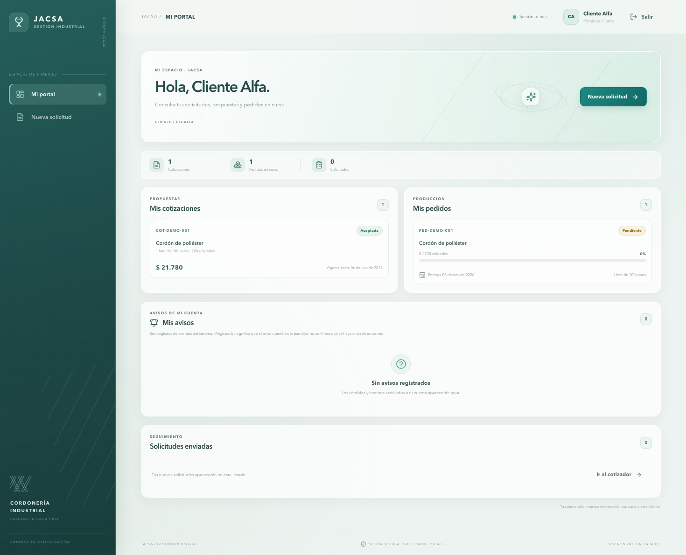
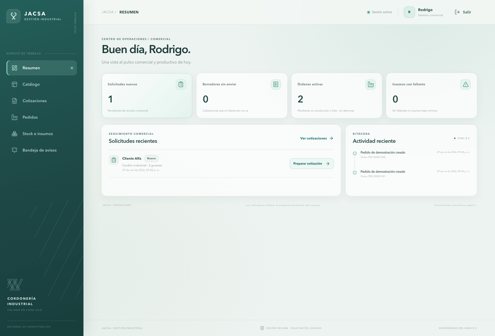
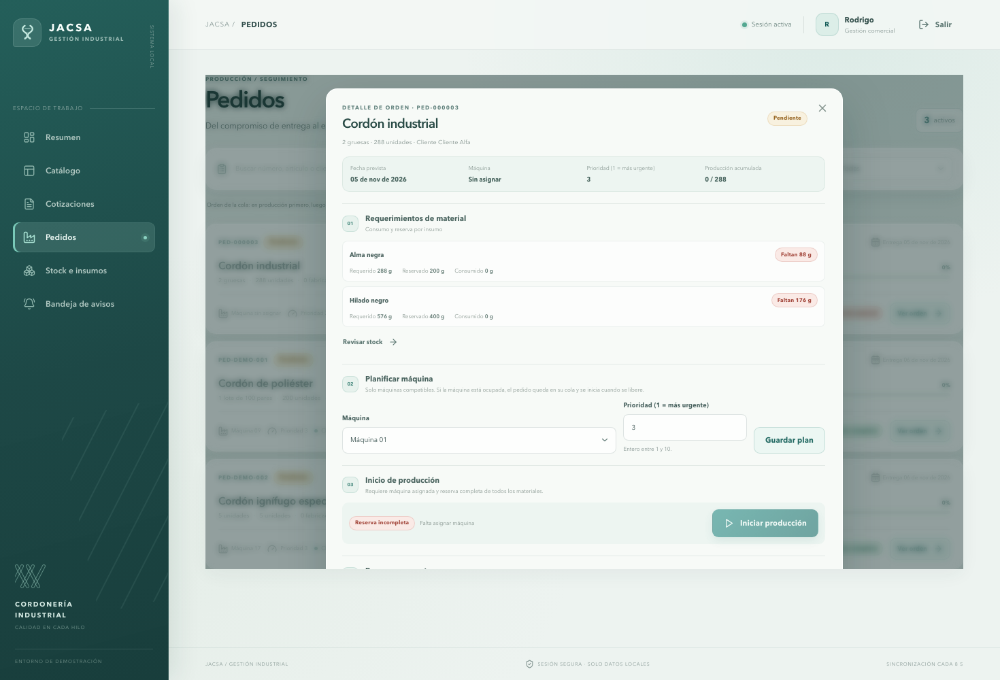
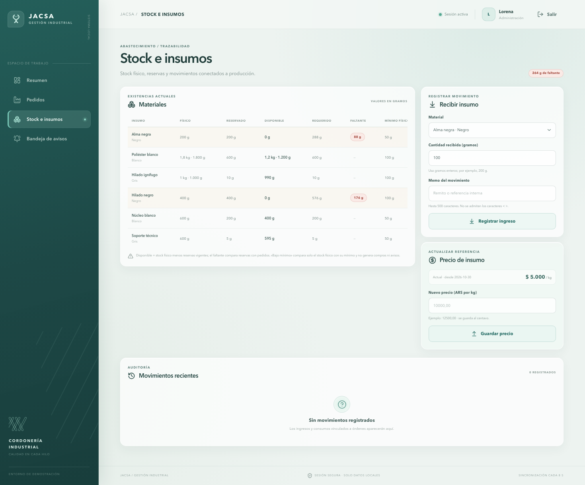
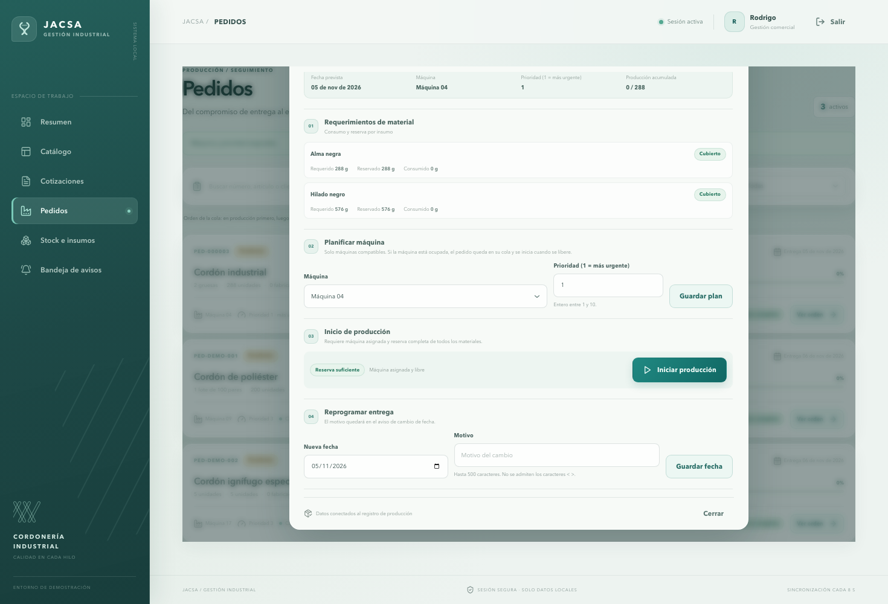
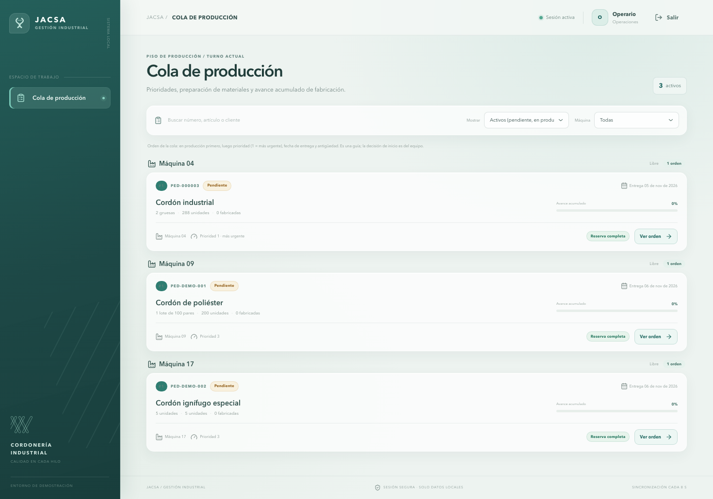
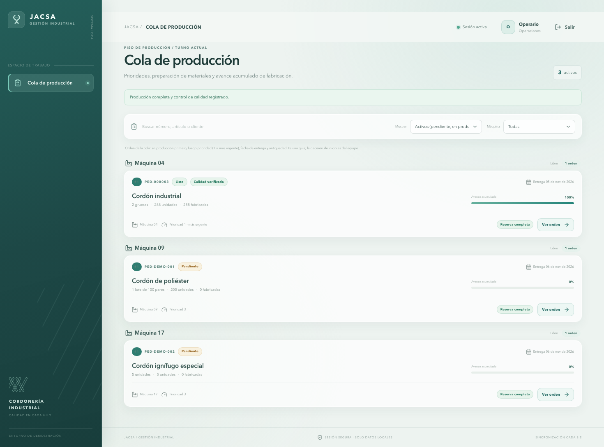
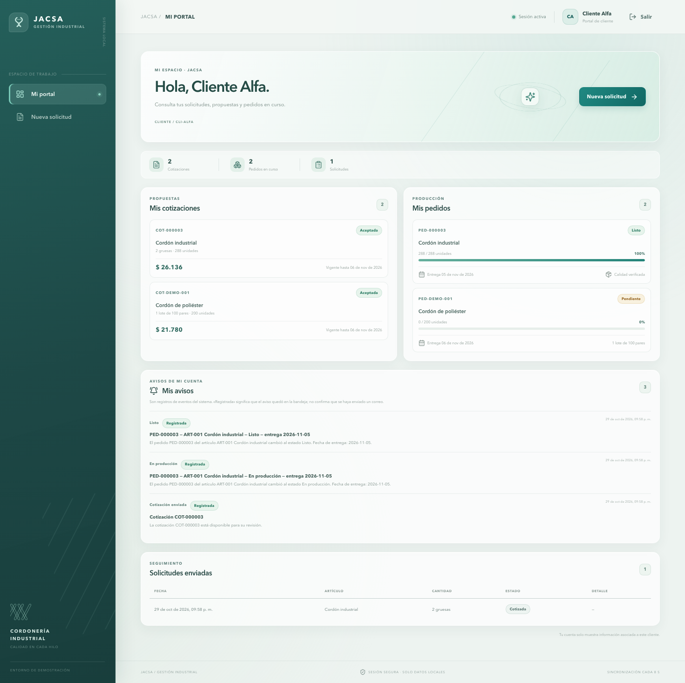
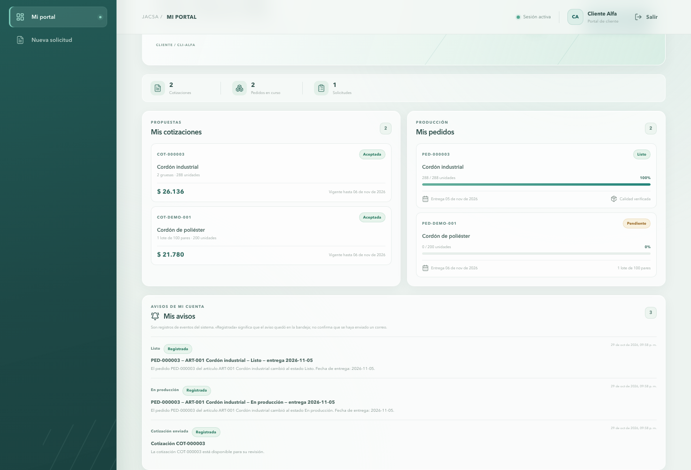

# Storyboard del video — cinco clips autónomos

**Estado:** integración del [diseño editorial definitivo](diseno-video-5min.md) con los checkpoints de la QA final del 2026-10-30 UTC; no existe todavía video ni ensayo de voz humana. Los fotogramas enlazados son capturas auténticas de UI de Playwright, no fotogramas de un MP4 ni capturas nuevas hechas para este documento. El [registro QA final](qa-final.md) informa 48/48 backend, build correcto, 50/50 E2E y 3/3 harness; sus tiempos automatizados no miden a las personas.

## Regla editorial y trazabilidad de la frontera B3/B4

Cinco clips editados, cada uno de **58 s** con título, acción/voz y transición o cierre incluidos: **5 × 58 = 290 s**. Objetivo total 285–295 s; máximo absoluto 300 s. No se añade intro ni outro por fuera de los clips. La locución actual suma **400 palabras** (ver desglose por Persona en [el guion](guion-presentacion.md)); el equipo aún debe leerla en voz alta y ensayarla con cronómetro.

Se conserva una diferencia histórica, no se simula que nunca existió: §8 de [`plan-qa-video.md`](plan-qa-video.md) propuso 291 s / 401 palabras y ubicó la planificación en B4. La versión previa del diseño editorial y el [`rehearsal.json`](../evidencias/qa-final/rehearsal/rehearsal.json) de QA registraban 290 s / 413 palabras y ubicaban el minicorte de planificación en **B3**, antes de la producción de **B4**. Este storyboard sigue esa división, verificada en la corrida final: `B3-C3-salida.png` es la captura real del manager con el plan y `B4-C3-entrada.png` la captura real del operario antes de producir. No se reasigna ni inventa una captura. El reparto original de locución del diseño/QA es 84/82/78/86/83. El ajuste final mantiene B1–B3 intactos y deja B4–B5 en 77/79: B4 cierra en «Listo, con el avance completo y el control de calidad registrado» sin locutar consumo ni saldo (esas cifras quedan en la guía y el JSON), y B5 dice «Se desplaza a Mis avisos» para nombrar la sección. El guion queda en 84/82/78/77/79, 400 palabras en total, dentro del objetivo; el conteo está en el propio [guion](guion-presentacion.md).

## Cifras de la historia

Cliente Alfa solicita ART-001, dos gruesas = 288 cordones; vista previa y cotización: 21.600 ARS netos, 4.536 ARS de IVA y 26.136 ARS total. Stock inicial 400 g de hilado negro y 200 g de alma negra; requerimiento 576 g / 288 g y faltante 176 g / 88 g. Ingresos 200 g / 100 g. El plan se guarda en Máquina 04, prioridad 1. Al finalizar 288 unidades, el saldo físico correcto es 24 g / 12 g; el control de calidad es un registro del operario. En C4 esos saldos quedan por debajo de los mínimos 100 g / 50 g.

## Línea de checkpoints

| Checkpoint | Estado de entrada/salida comprobable | Evidencia de estado |
|---|---|---|
| C0 | Seed limpio para esta historia: sin solicitud, cotización ni pedido de Alfa; stocks iniciales 400/200 g. Permanecen los dos pedidos seed de otros artículos. | Captura de entrada B1 y snapshot C0 en `rehearsal.json`. |
| C1 | Solicitud de Alfa nueva para ART-001, 2 gruesas / 288; la vista previa se comprobó en UI. | Captura de salida B1 y entrada B2; snapshot C1. |
| C2 | Cotización aceptada convertida en un pedido Pendiente; reservas 400/200 g, faltantes 176/88 g. | Captura de salida B2 y entrada B3; snapshot C2. |
| C3 | Tras ingresos 200/100 g y planificación, reserva completa; pedido sigue Pendiente en M-04, prioridad 1. Físico 600/300 g; disponible 24/12 g. | Captura real de salida B3 del manager; entrada B4 del operario; snapshot C3. |
| C4 | Pedido Listo, 288/288, QC registrado; consumo 576/288 g y saldo físico 24/12 g, ambos bajo mínimo. B5 comienza y termina en C4. | Capturas de salida B4 y entrada/salida B5; snapshots C4. El consumo, el saldo y los mínimos se verifican en el JSON; no se locutan en B4 ni aparecen como inventario en la captura del operario. |

Los identificadores `request-*`, `quote-*`, `order-*`, `notification-*` y el número de pedido son dinámicos por ejecución. Los IDs del seed (CLI-ALFA, ART-001, INS-NEGRO, INS-ALMA y M-04) sí identifican las entidades de la historia. No transcribir un UUID o número PED del JSON como si fuera permanente.

## Cronograma por subsegmento

Los tramos siguientes son **presupuestos editoriales**, no tiempos medidos por la aplicación ni una promesa de que alguien complete una acción en ese intervalo. El diseño definitivo supone 130–150 palabras por minuto (ritmo supuesto, no medido); las palabras se dicen mientras se ejecuta o se sostiene la UI. Mantener cada cifra clave en pantalla al menos 2 s y no acelerarla.

| Clip y ventana | Tramos locales (segundos) | Entrada → acción → resultado/cierre |
|---|---|---|
| **B1 · Persona1 · 0:00–0:58** | 0–3 título (3); 3–14 elegir ART-001 y cantidad (11); 14–30 mostrar vista previa y locutar importes (16); 30–48 teléfono, consentimiento y envío (18); 48–56 sostener solicitud Nueva y cierre narrado (8); 56–58 transición (2). **Total 58.** | Solicitudes enviadas sin la solicitud de esta historia (el seed conserva otros registros) → configurar y enviar → solicitud Nueva, con su captura de salida. |
| **B2 · Persona2 · 0:58–1:56** | 0–3 título (3); 3–11 localizar solicitud (8); 11–23 fijar 25 % / 7 días y crear (12); 23–39 enviar, registrar aceptación y convertir (16); 39–56 mostrar pedido, reservas y faltantes (17); 56–58 transición (2). **Total 58.** | Solicitud Nueva → cotizar y convertir → pedido Pendiente con 400/200 g reservados y 176/88 g faltantes. |
| **B3 · Persona3 · 1:56–2:54** | 0–3 título (3); 3–15 leer faltantes en Stock (12); 15–28 registrar 200 g de hilado (13); 28–37 registrar 100 g de alma (9); 37–38 microrrótulo «Rodrigo · planificación» (1); 38–48 guardar M-04 / prioridad 1 (10); 48–56 sostener faltantes cero, movimientos y reserva completa (8); 56–58 transición (2). **Total 58.** | Faltantes 176/88 g → ingresos y minicorte real de rol a manager → faltantes cero y plan en C3. |
| **B4 · Persona4 · 2:54–3:52** | 0–3 título (3); 3–13 mostrar cola y reserva completa (10); 13–22 abrir orden e iniciar (9); 22–40 cargar 288, marcar QC y guardar (18); 40–56 sostener pedido Listo, avance y QC (16); 56–58 transición (2). **Total 58.** | Operario en cola, orden Pendiente en M-04 → producción y registro de QC → pedido Listo. El consumo y el saldo 24/12 g son estado C4 verificado en el JSON; no se locutan ni se finge que la UI de cola los muestre. |
| **B5 · Persona5 · 3:52–4:50** | 0–3 título (3); 3–13 entrar al portal y ubicar el pedido (10); 13–33 mostrar 288/288 y Calidad verificada (20); 33–47 desplazarse a Mis avisos (14); 47–52 sostener eventos Registrada y locutar el límite (5); 52–58 cierre visual (6). **Total 58.** | Cliente Alfa con pedido Listo → seguimiento en su propio portal → avisos registrados, sin envíos externos; cerrar con la leyenda institucional. |
| **Suma** | **290 s** | No se agrega tiempo fuera de B1–B5. |

## Fotogramas reales de referencia

Las capturas de entrada y salida existen en `evidencias/qa-final/rehearsal/` y corresponden a los puntos `captures` del JSON final. Sirven para cotejar contexto, rol y estado; el montaje final debe grabar la aplicación y no presentar imágenes fijas como video.

### B1 — C0 → C1

Entrada real: [B1-C0-entrada.png](../evidencias/qa-final/rehearsal/B1-C0-entrada.png). Salida real: [B1-C1-salida.png](../evidencias/qa-final/rehearsal/B1-C1-salida.png).

### B2 — C1 → C2

Entrada real: [B2-C1-entrada.png](../evidencias/qa-final/rehearsal/B2-C1-entrada.png). Salida real: [B2-C2-salida.png](../evidencias/qa-final/rehearsal/B2-C2-salida.png).

### B3 — C2 → C3

Entrada real: [B3-C2-entrada.png](../evidencias/qa-final/rehearsal/B3-C2-entrada.png). Salida real: [B3-C3-salida.png](../evidencias/qa-final/rehearsal/B3-C3-salida.png).

### B4 — C3 → C4

Entrada real: [B4-C3-entrada.png](../evidencias/qa-final/rehearsal/B4-C3-entrada.png). Salida real: [B4-C4-salida.png](../evidencias/qa-final/rehearsal/B4-C4-salida.png).

### B5 — C4 → C4

Entrada real: [B5-C4-entrada.png](../evidencias/qa-final/rehearsal/B5-C4-entrada.png). Salida real: [B5-C4-salida.png](../evidencias/qa-final/rehearsal/B5-C4-salida.png).

## Contraste entre presupuesto y automatización observada

El JSON de QA registra `browserUiActions` medidas por Playwright. Sumadas por bloque, las acciones cronometradas dieron los valores siguientes; se redondean al milisegundo. Incluyen esperas/asserts dentro de cada acción y **no** incluyen toda la navegación, checkpoints API, capturas, cambio de perfil, voz, tiempo de pantalla ni edición. No son ensayos humanos ni duración de clips.

| Bloque | Presupuesto editorial | Suma de entradas `browserUiActions` en el JSON | Qué se cronometró |
|---|---:|---:|---|
| B1 | 58 s | 642 ms | Abrir solicitud, configurar y ver vista previa, completar contacto/consentimiento, enviar y volver al portal. |
| B2 | 58 s | 1.310 ms | Localizar, preparar y crear cotización, enviar, aceptar, convertir y abrir el pedido. |
| B3 | 58 s | 1.442 ms | Dos ingresos y el minicorte de Rodrigo para planificar. |
| B4 | 58 s | 629 ms | Iniciar y registrar 288 unidades con QC. |
| B5 | 58 s | 78 ms | Revisar pedido en portal y desplazarse a los avisos. |
| **Total** | **290 s** | **~4.100 ms de acciones cronometradas** | Suma de valores originales antes de redondear filas; `automationElapsedMs` de Playwright fue ~6.602 ms y tampoco es tiempo del video. |

La diferencia grande entre el presupuesto y los milisegundos automatizados es esperable: una acción de Playwright ejecuta controles y comprobaciones sin leer la narración, sostener cifras durante varios segundos ni realizar una actuación humana. El grupo debe ensayar, medir cada clip montado y recortar o redistribuir pausas sin superar 300 s.

## Reglas de montaje y límites

- Grabar los cinco segmentos como clips distintos. Mantener el rótulo de entrada y una salida/cierre en cada archivo; no depender del clip anterior para entender cliente, rol ni estado inicial.
- B3 contiene el minicorte de Lorena a Rodrigo para planificar; B4 queda solo para el operario; B5 solo muestra el portal del cliente. No alternar con la bandeja interna.
- Mantener los importes legibles; no acelerar cifras. No añadir una captura de stock posterior a producción como si fuera parte de B4: el checkpoint C4 del JSON confirma 24/12 g y los dos indicadores bajo mínimo, pero la captura final B4 es de la cola del operario. Estos indicadores no generan avisos ni órdenes de compra.
- No afirmar que la voz se ensayó, que se aprobó el montaje o que existe MP4. No afirmar envío de avisos: «Registrada» solo describe almacenamiento local.
- La adaptación a cuatro voces es opcional: ver el reparto breve en el [guion](guion-presentacion.md); la propuesta principal sigue siendo Persona1–Persona5.
